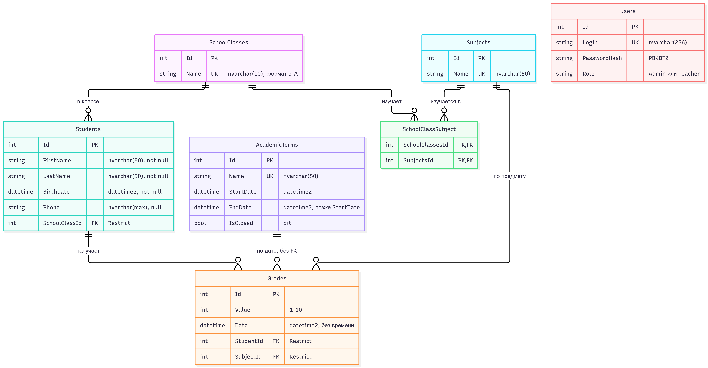
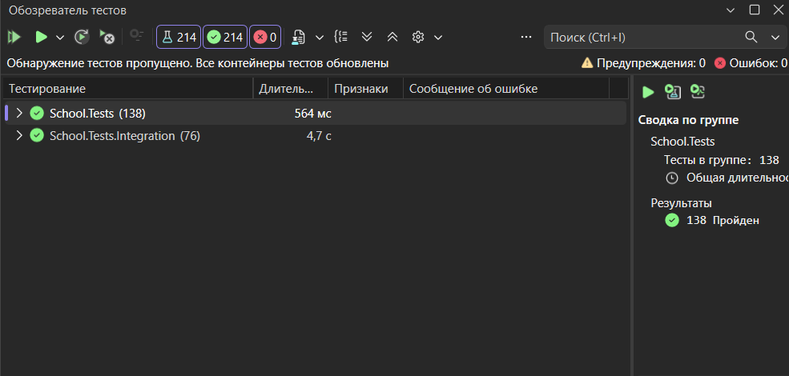

# Школа - учебный проект на C# / .NET 8

Это мой учебный проект - веб-приложение для управления данными школы: ученики, классы, предметы, оценки, учебные периоды и табель успеваемости. Делал на C# и .NET 8, с многослойной (N-tier) архитектурой и MS SQL Server в качестве базы данных.

## Стек технологий

- C#, .NET 8, ASP.NET Core
- Blazor Web App (Interactive Server) - для UI
- Microsoft SQL Server (Developer Edition)
- Entity Framework Core 8 (Code First)
- xUnit + Moq - юнит-тесты
- SQLite in-memory - интеграционные тесты слоя данных
- Cookie-based аутентификация, роли Admin / Teacher

## Архитектура

Проект разбит на слои, каждый в своём проекте:

- **School.Domain** - модели (Student, SchoolClass, Subject, Grade, User, AcademicTerm) и правила валидации через Data Annotations. Ни от чего не зависит
- **School.Data.Contracts** - интерфейсы репозиториев, свои типы исключений (`DuplicateNameException`, `EntityInUseException`) и модели для чтения (`PagedResult`, `GradeStat` и т.д.)
- **School.Data** - EF Core: DbContext, миграции и реализации репозиториев
- **School.Services** - бизнес-логика, валидация, табель и экспорт в CSV
- **School.Web** - Blazor UI
- **School.Tests** - юнит-тесты сервисов (Moq)
- **School.Tests.Integration** - интеграционные тесты репозиториев на SQLite

Зависимости:

```
School.Web ──► School.Services ──► School.Data.Contracts ──► School.Domain
     │                                      ▲
     └──────► School.Data ──────────────────┘
```

`School.Services` ссылается **только** на `School.Data.Contracts`, поэтому бизнес-слой физически не может дотянуться до `DbContext` - это проверяет компилятор. Ошибки базы (нарушение уникального индекса, нарушение связи) ловятся в репозиториях и превращаются в свои исключения, так что в сервисах нет ни одного `using Microsoft.EntityFrameworkCore`. `School.Web` ссылается на `School.Data` только чтобы зарегистрировать DbContext и репозитории в DI.

## Схема базы данных

База нормализована (3НФ): 6 основных таблиц и одна промежуточная для связи многие-ко-многим между классами и предметами.

- **Students** - ученики (многие-к-одному с SchoolClasses)
- **SchoolClasses** - классы
- **Subjects** - предметы (многие-ко-многим с SchoolClasses через SchoolClassSubject)
- **Grades** - оценки (связаны со Students и Subjects)
- **AcademicTerms** - учебные периоды (четверти). С оценками связаны по дате, а не внешним ключом - почему так, написано ниже
- **Users** - пользователи системы

Удаление везде `Restrict`: класс с учениками, ученика с оценками и предмет с оценками удалить нельзя, приложение покажет понятное сообщение. Названия классов, предметов, периодов и логины уникальны на уровне БД.



## Что умеет приложение

- **Ученики** - добавление, редактирование, удаление; фильтр по классу и фамилии работает в SQL, список разбит на страницы по 20 человек
- **Классы** - создание, состав класса, привязка предметов. Название в формате `9-А`: номер от 1 до 12 и заглавная русская буква
- **Предметы** - список и редактирование
- **Учебные периоды** - четверти с датами начала и конца; периоды не пересекаются, закрытый период нельзя менять
- **Журнал оценок** - оценки по 10-балльной шкале, средний по каждому предмету и общий, фильтр по датам. Оценку можно поставить только по предмету класса ученика, только на дату внутри открытого периода и не в будущем
- **Табель** - таблица «ученики × предметы» за выбранный период и класс со средними и итоговыми оценками, экспорт в CSV
- **Пользователи** - администратор видит всех пользователей и меняет им роль
- Вход и регистрация; удалять данные, закрывать периоды и управлять пользователями может только Admin
- Логирование через ILogger: каждое изменение данных пишется в лог, каждая ошибка на странице - через `LogError` с названием операции и Id

## Учебные периоды и привязка оценок

Каждый период - это название, дата начала, дата окончания (строго позже начала) и признак «закрыт». Периоды не пересекаются, но могут идти стык в стык: следующий начинается на следующий день после конца предыдущего. Даты хранятся без времени, поэтому оценка в первый и последний день периода точно в него попадает.

Правила:

- оценку можно поставить, изменить или удалить, только если её дата попадает в **открытый** период. При изменении проверяется и старая, и новая дата, так что оценку нельзя ни вытащить из закрытой четверти, ни перенести в неё
- у закрытого периода можно только снять закрытие, остальные поля не редактируются
- период с оценками и закрытый период удалить нельзя

**Как оценка привязана к периоду.** Я выбрал вариант без внешнего ключа: период определяется по дате оценки каждый раз, когда это нужно. Дата оценки - это факт («оценку поставили 8 ноября»), а принадлежность к четверти из неё следует. Если хранить ещё и `AcademicTermId`, появляются два источника правды, которые могут разойтись: после сдвига границ четверти оценка от 8 ноября может числиться в периоде, который заканчивается 5 ноября. Сдвиг границ при моём подходе работает как в реальной школе: если завуч перенёс конец I четверти с 31.10 на 03.11, оценки за 1-3 ноября автоматически относятся к I четверти. При этом итоги уже закрытых четвертей измениться не могут: у закрытого периода нельзя менять даты, а в закрытом периоде нельзя менять оценки. Ещё один плюс - старые оценки в базе не пришлось переносить миграцией.

Цена этого решения - запрет «нельзя удалить период с оценками» проверяется в сервисе запросом, а не ограничением `Restrict` в базе, потому что внешнего ключа нет. Сдвигать границу между двумя соседними периодами нужно в два шага: сначала сузить один, потом расширить второй (иначе на момент сохранения они пересекутся).

## Табель и итоговая оценка

На экране «Табель» выбираешь период и класс и получаешь таблицу: строки - ученики, столбцы - предметы класса.

- в клетке - средний балл ученика по предмету за период; если оценок нет, клетка пустая
- «Средний» - средний по **всем** оценкам ученика за период (не среднее от средних по предметам), в скобках итоговая оценка
- последняя строка - средний по классу по каждому предмету, тоже по всем оценкам

Итоговая оценка округляется через `Math.Round(average, MidpointRounding.AwayFromZero)`. Обычный `Math.Round(8.5)` в .NET даёт **8** (банковское округление к чётному), а для школьной оценки 8.5 должно быть 9. На это есть тест `8.5 → 9`, `7.5 → 8`, `6.5 → 7`.

Табель собирается за 4 запроса к базе на любой размер класса: период, класс с предметами, ученики и один сгруппированный запрос «ученик + предмет → сумма и количество оценок».

## Экспорт табеля в CSV

Кнопка «Скачать CSV» на экране табеля. Файл называется по классу и периоду транслитом, например `tabel-5-A-I-chetvert.csv`.

**Как открыть:** просто двойной щелчок - файл откроется в Excel сразу с колонками и нормальной кириллицей. Для этого:

- файл в UTF-8 с BOM - иначе Excel на Windows читает его в системной кодировке и кириллица превращается в кракозябры
- разделитель `;` и дробные числа через запятую (`8,50`) - так ждёт Excel с русскими региональными настройками. Если у тебя Excel с английскими настройками, открывай через «Данные → Из текста/CSV» и выбирай разделитель «точка с запятой»
- если имя начинается с `=`, `+`, `-` или `@`, перед ним ставится апостроф, чтобы Excel не выполнил его как формулу

## Пользователи и роли

Первый зарегистрированный пользователь становится **Admin**, все следующие - **Teacher**. На странице «Пользователи» администратор меняет роли. Свою роль поменять нельзя - так в системе всегда остаётся хотя бы один администратор.

Роль хранится в cookie, но при каждом запросе сверяется с базой: если роль изменили, cookie сразу перевыпускается с новой ролью, а если пользователя больше нет - его разлогинивает. Новая роль начинает действовать после обновления страницы у этого пользователя.

## Что нужно для запуска

- Visual Studio 2022+ с рабочей нагрузкой "ASP.NET и веб-разработка"
- .NET 8 SDK
- Microsoft SQL Server (полная версия, не LocalDB)
- SSMS - по желанию

## Как запустить

### 1. Клонируем репозиторий

```
git clone https://github.com/mihailovp04-projects/school_project.git
cd school_project
```

### 2. Строка подключения

В `School.Web/appsettings.json` сделать под свой сервер:

```json
"ConnectionStrings": {
  "SchoolDb": "Server=localhost;Database=SchoolDb;Trusted_Connection=True;TrustServerCertificate=True;"
}
```

### 3. Миграции

В Package Manager Console (Visual Studio):

```
Update-Database -Project School.Data -StartupProject School.Web
```

Создаст базу `SchoolDb` со всеми таблицами. Названия классов и предметов, а также логины пользователей уникальны на уровне БД: если в уже существующей базе есть дубликаты, миграцию нужно применять после их удаления.

### 4. Запуск

Стартовый проект - **School.Web**, дальше **F5** (или **Ctrl+F5** без отладчика). Откроется в браузере, что-то вроде `https://localhost:7266`.

### 5. Первый пользователь и первые периоды

Пользователей в базе сначала нет. Идём на `/register` и регистрируемся - первый зарегистрированный автоматически становится **Admin**. Если таблицу `Users` очистить, следующий зарегистрированный снова станет **Admin**, поэтому после очистки базы регистрируйтесь первым сами.

Дальше нужно создать учебные периоды на странице «Учебные периоды»: без них оценку поставить нельзя. Если в базе уже были оценки до появления периодов, их нельзя изменить, пока не создан период, в который попадает их дата (удалить можно).

## Тесты

Всего 214 тестов: 138 юнит-тестов на сервисы и 76 интеграционных на репозитории.

Запуск: Тест → Обозреватель тестов → Запустить все. Или из корня решения:

```
dotnet test
```



### Интеграционные тесты

Проект `School.Tests.Integration` гоняет настоящие репозитории на **SQLite в памяти**. Провайдер `InMemory` для этого не подходит: он не проверяет ни внешние ключи, ни уникальные индексы, и тест на запрет удаления прошёл бы даже при `Cascade`. SQLite проверяет и то, и другое.

Каждый тест получает свою чистую базу: соединение открывается в конструкторе тестового класса, таблицы создаются через `EnsureCreated`, в `Dispose` соединение закрывается и база исчезает. Ничего настраивать не нужно, SQL Server для этих тестов не нужен.

Граница проверки: SQLite сравнивает строки с учётом регистра, а SQL Server в проде - без. Поэтому «Математика» против «математика» на SQLite не дубликат, хотя в проде дубликат - это зафиксировано отдельным тестом с комментарием.

## Осознанные решения и отступления от задания

- **Привязка оценки к периоду - по дате, без внешнего ключа** (вариант 2 из задания). Почему - в разделе про учебные периоды. Из-за этого запрет на удаление периода с оценками сделан в сервисе, а не через `Restrict`.
- **Период из одного дня создать нельзя.** В задании сказано, что дата окончания строго позже даты начала, - этому правилу и следую.
- **Закрывать и открывать периоды может только Admin**, хотя задание явно ограничивает только удаление. Иначе любой учитель мог бы открыть закрытую четверть и поменять итоговые оценки.
- **Средний по классу в табеле считается по всем оценкам предмета**, а не как среднее от средних учеников - так же, как средний ученика.
- **Типы исключений лежат в `School.Data.Contracts`**, а не в `School.Domain`: так требует пункт про отдельный проект с контрактами, а исключения описывают ошибки хранилища, не предметной области.
- **Проект `School.Data.Contracts` сделан сразу после переноса исключений**, а не в конце, чтобы новый код периодов и табеля сразу ложился в правильные проекты.
- **Логирование ошибок на страницах сделано до новых экранов** и живёт в общем базовом классе `PageBase`. Логгер создаётся там с категорией конкретной страницы - в логе это то же самое, что `@inject ILogger<Students>`, но без одинаковой строки в каждой странице. Отмена операции (`OperationCanceledException`) ошибкой не считается.
- **Из подсчёта покрытия исключены миграции** (`coverage.runsettings`): это код, который сгенерировал EF, тесты его не исполняют, потому что база в тестах создаётся через `EnsureCreated`.
- **Название класса - только кириллица**: иначе «5-А» и «5-A» были бы двумя разными классами, которые выглядят одинаково.

## Структура

```
School/
├── School.Domain/              # модели и правила валидации
├── School.Data.Contracts/      # интерфейсы репозиториев, исключения, модели чтения
├── School.Data/                # EF Core, репозитории, миграции
├── School.Services/            # бизнес-логика, табель, CSV
├── School.Web/                 # Blazor UI
├── School.Tests/               # юнит-тесты
├── School.Tests.Integration/   # интеграционные тесты на SQLite
├── coverage.runsettings        # настройки подсчёта покрытия
└── docs/
    ├── er-diagram.png          # ER-диаграмма
    └── tests.png               # скриншот прогона тестов
```